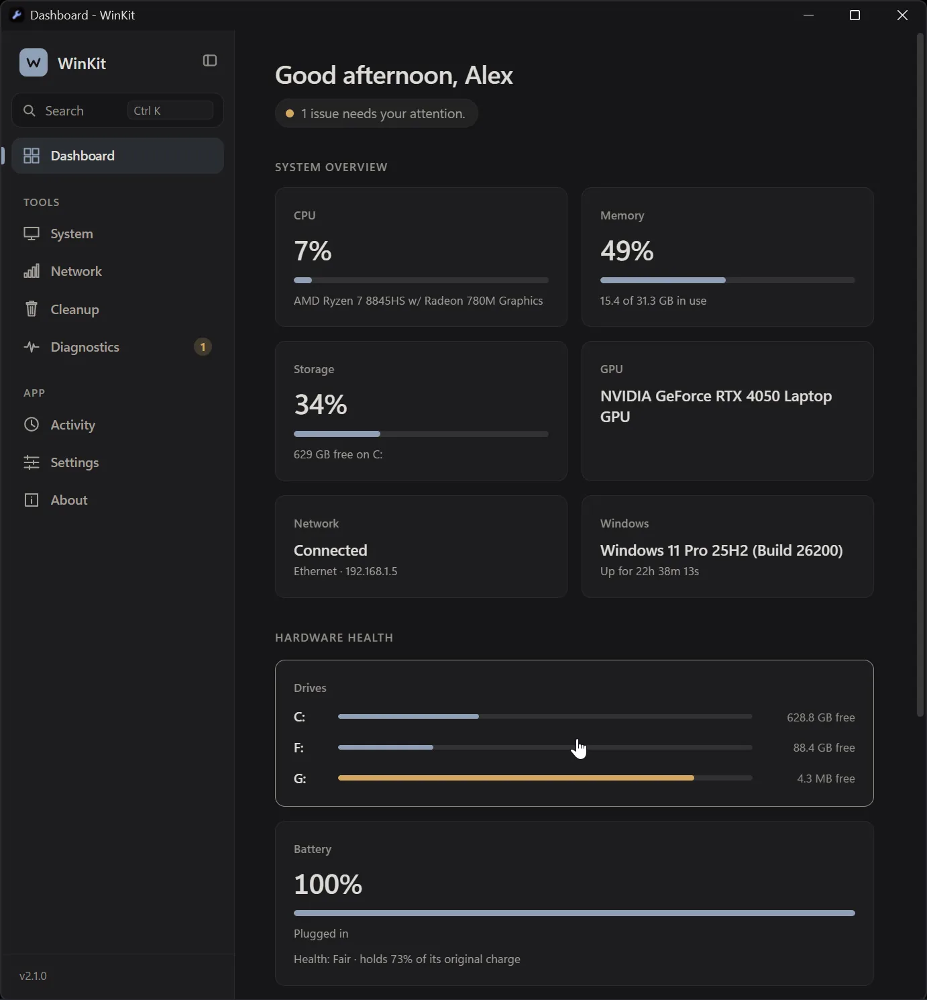

# WinKit

Windows administration, without the clutter. A small, calm toolkit for Windows 10 and 11: system overview, diagnostics, disk usage, Wi-Fi and network tools, cleanup and more. One portable file under 1 MB, no account, no telemetry.

- **Website and downloads:** https://im4theone.github.io/WinKit/
- **Releases:** https://github.com/Im4Theone/WinKit/releases
- **Changelog:** [CHANGELOG.md](CHANGELOG.md)
- **License:** [MIT](LICENSE)

## Building

Windows with Visual Studio Build Tools (C++) is all that is needed. Run `build.bat` to get `WinKit.exe`, or `release.bat` for the portable exe, zip, installer (needs Inno Setup 6) and checksums. The interface sources live in `css/`, `js/` and `pages/`; `build_ui.py` assembles them. The native modules (`mod_*.h`) are documented in the `API_*.md` files.

## Code signing policy

Free code signing provided by [SignPath.io](https://signpath.io), certificate by [SignPath Foundation](https://signpath.org).

WinKit is applying to the SignPath Foundation program. Until signing is in place, releases are unsigned and Windows SmartScreen may show an "unknown publisher" notice; every download has a SHA-256 checksum. Only `WinKit.exe` and the installer, built from this repository by an automated GitHub Actions build, will be signed. The project owner ([Im4Theone](https://github.com/Im4Theone)) is the author, reviewer and approver, and approves every signing request by hand with multi-factor authentication.

## Privacy policy

WinKit has no account, no analytics and no telemetry. Settings and history stay on your PC in `%LOCALAPPDATA%\WinKit`. The program does not transfer information to other systems unless you ask it to. The only network use is an optional update check against GitHub Releases (can be turned off in Settings), downloading an update when you choose it, an error report only when you press Send, the hosts you enter in the network tools, and the Microsoft Edge WebView2 Runtime that Windows provides. Full details: https://im4theone.github.io/WinKit/#privacy
